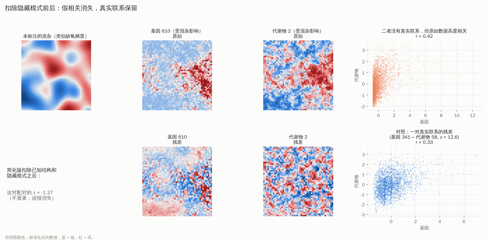

# ReSPAIR

[![Tests][badge-tests]][tests]
[![Documentation][badge-docs]][documentation]
[![License: MIT][badge-license]](LICENSE)
[![Python][badge-python]](pyproject.toml)

[badge-tests]: https://img.shields.io/github/actions/workflow/status/lingzhuu/ReSPAIR/test.yaml?branch=main&label=tests
[badge-docs]: https://img.shields.io/readthedocs/respair
[badge-license]: https://img.shields.io/badge/license-MIT-blue.svg
[badge-python]: https://img.shields.io/badge/python-3.10%2B-blue.svg
[tests]: https://github.com/lingzhuu/ReSPAIR/actions/workflows/test.yaml
[documentation]: https://respair.readthedocs.io

**ReSPAIR** finds *pair-specific* gene–metabolite links
in spatial transcriptomics + spatial metabolomics data measured on the same tissue section, **after removing known
tissue structure and every hidden spatial pattern** that moves many molecules together.

<p align="center"></p>

## Why

Plain correlation between a gene and a metabolite map is dominated by tissue regions and unlabeled gradients
(hypoxia, inflammation, section artefacts). ReSPAIR models both modalities as

```
G = Z B_gᵀ + F Λ_gᵀ + E_g
M = Z B_mᵀ + F Λ_mᵀ + E_g Wᵀ + E_m
```

where `Z` is known structure (e.g. cell-type proportions), `F` are hidden spatial factors treated as confounding,
and the sparse matrix `W` holds the links to be tested: does metabolite *k* follow the *local residual* of gene *j*?

The current release implements the **simplified (step-wise) estimator**:

1. Normalise genes with analytic Pearson residuals and metabolites with log + standardisation.
2. Regress out `Z` and `K` hidden factors from a jointly weighted PCA of both modalities (`K` chosen from the
   singular-value spectrum).
3. Project residuals onto a spatial frequency basis (kNN-graph Laplacian eigenvectors) and test all pairs at once,
   with a null variance from the band-wise power spectrum of both sides (accounts for spatial autocorrelation).
4. Optionally calibrate z-scores with negative-control genes.

## Installation

ReSPAIR needs Python ≥ 3.10.

```bash
pip install git+https://github.com/lingzhuu/ReSPAIR.git
```

For development (tests, benchmark scripts):

```bash
git clone https://github.com/lingzhuu/ReSPAIR.git
cd ReSPAIR
pip install -e ".[dev]"
pre-commit install
```

## Quick start

```python
import respair
from respair.simulate import simulate

d = simulate(seed=0)                        # or your own data, see below
res = respair.fit(
    d["G"],                                 # n_spots × n_genes counts
    d["M"],                                 # n_spots × n_metabolites intensities
    d["coords"],                            # n_spots × 2 coordinates
    Z=d["Z"],                               # known structure, e.g. cell-type proportions (optional)
    neg_genes=d["neg_genes"],               # negative-control gene indices (optional)
)
res["z"], res["p"]                          # n_genes × n_metabolites
res["K"]                                    # number of hidden factors removed
res["z_scale"]                              # z on large / medium / small spatial scales
hits = respair.bh(res["p"], alpha=0.1)      # Benjamini–Hochberg
```

Both modalities must be on the same spots; aggregate MSI pixels to the transcriptomics grid first.

## Simulation benchmark

50 × 50 grid, 2,000 genes, 200 metabolites, 3 cell types as known structure, one unlabeled smooth confounder
affecting 300 genes and 40 metabolites, private hidden factors on each side, 150 true links (strength 0.5),
negative-binomial counts. Mean over 5 seeds:

| Method | AUC (all null pairs) | Power at 5% FPR | AUC (confounded pairs only) | Power at 5% FPR |
|---|---|---|---|---|
| Pearson correlation | 0.888 | 0.544 | 0.763 | 0.275 |
| MANTIS-SCI | 0.539 | 0.069 | 0.389 | 0.029 |
| MANTIS-SPC-CT | 0.762 | 0.203 | 0.194 | 0.000 |
| **ReSPAIR (simplified)** | **1.000** | **1.000** | **1.000** | **1.000** |

Ablations, false-positive rates and FDR are in [`benchmarks/`](benchmarks/README.md); MANTIS is our
re-implementation of the bioRxiv preprint.

## Documentation

- Model and design rationale: [docs/model.md](docs/model.md)
- API reference: built with Sphinx from `docs/` (`pip install -e ".[doc]" && make -C docs html`)

## Roadmap

- Full (joint) estimator of `F` and `W`.
- AnnData / SpatialData input.
- Sparse eigensolvers for > 10k spots; mismatched grids (MSI pixels vs. Visium spots).
- Application to the striatum SMA dataset of Vicari et al.

## Citation

A manuscript is in preparation. Until then, please cite the software via [CITATION.cff](CITATION.cff).

## License

[MIT](LICENSE)
